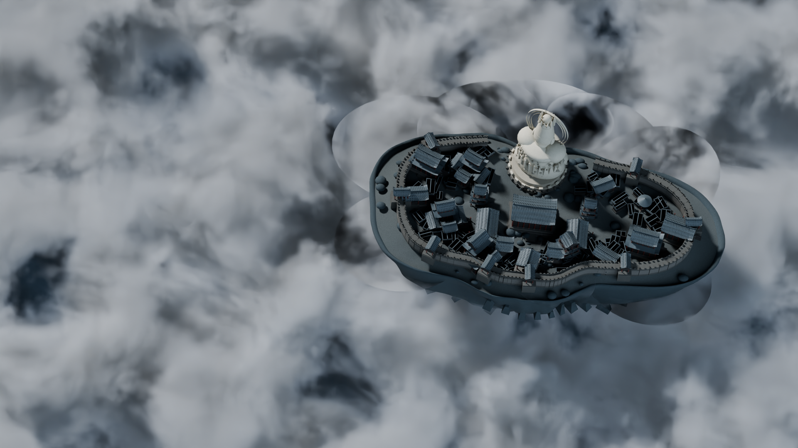
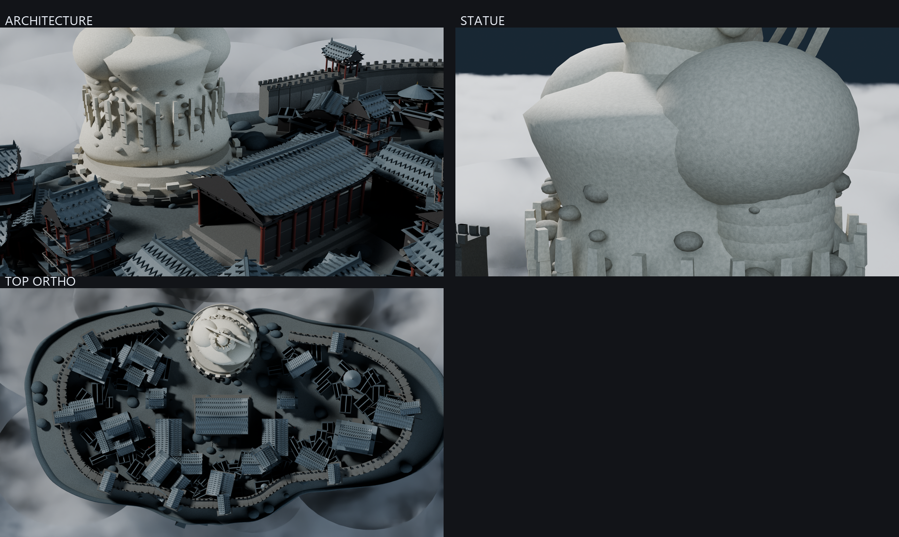

# 浮岛佛国 · Floating Island Temple

一个完全由 Blender Python 程序化生成的浮空岛屿场景：高空俯视、右侧岛体、北缘巨像、
左侧连续体积云海、冷灰蓝光照。可复现、可编辑、可导出。



## 这是什么

不是贴图拼的，也不是二维生成图。所有几何、材质、云和光照都由 Python 脚本在 Blender 里
真实构建，最终用 Cycles 渲染成图。

- **岛体**：约 240m × 116m 的不规则椭圆浮岛，13 段收分崖壁剖面 + fbm 噪声扰动
- **巨像**：北缘浅色风化石灰岩坐像，冠饰 / 肩臂 / 衣褶 / 光环，下部由云掩埋
- **建筑**：标准构件 → 10 类参数化模板 → 院落 → 群落，四层生成流水线
- **云海**：真三维体积材质（Principled Volume + 多层 Noise），非平面贴图
- **光照**：左上方大面积柔光 + 低强度冷环境填充，Cycles 渲染 + OpenImageDenoise



## 环境要求

| 项目 | 版本 |
|---|---|
| Blender | 5.2 LTS（5.0+ 应该也能跑，未验证） |
| Python | Blender 内置即可，无需额外安装 |
| 可选 | PIL / numpy（仅 `compare.py` 生成对比图时需要） |

无需 GPU：Cycles 走 CPU 也能渲。有 GPU 会快很多。

## 快速开始

```bash
# 1. 重建整个场景并保存 .blend
blender -b --factory-startup --python build_scene.py -- --stage all --save scene.blend

# 2. 渲染主画面 1080p
blender -b scene.blend --python render_from_blend.py -- \
    --cam CAM_Main --res 1920x1080 --samples 48 --out out/final_1920.png

# 3. 2 倍图
blender -b scene.blend --python render_from_blend.py -- \
    --cam CAM_Main --res 3840x2160 --samples 32 --steps 3.0 --out out/final_3840.png

# 4. 三台检查相机
blender -b scene.blend --python render_from_blend.py -- --cam CAM_Architecture --res 1920x1080 --samples 40 --out out/check_arch.png
blender -b scene.blend --python render_from_blend.py -- --cam CAM_Statue       --res 1920x1080 --samples 40 --out out/check_statue.png
blender -b scene.blend --python render_from_blend.py -- --cam CAM_Top          --res 1920x1080 --samples 32 --out out/check_top.png
```

也可以直接用 Blender 打开 `scene.blend`，四台相机都在 `CAMERAS` 集合里。

```bash
# 构图数值校验（不渲染，秒出）
blender -b --factory-startup --python verify.py

# 与参考图对比（把参考图存成 reference.png 放项目根目录）
python compare.py out/final_1920.png
```

## 文件结构

```
sk_core.py         几何/噪声/材质内核，含全部全局参数 CFG
sk_island.py       岛体：顶面地形、外挑崖缘、13 段崖壁剖面
sk_statue.py       巨像：放样躯干、冠饰、肩臂、衣褶、光环
sk_parts.py        标准构件 + 10 类建筑模板
sk_city.py         城墙带、Poisson Disk 院落、核心高台区、填充屋
sk_atmo.py         体积云、光照、相机、渲染设置
build_scene.py     装配驱动（岛→像→城→云→相机）
calibrate.py       主相机两阶段参数搜索（对齐构图目标框）
verify.py          投影校验：把每个约束算成数字
compare.py         并排 / 叠加 / 差分图（无参考图时退化为自检图）
render_from_blend.py  从 .blend 单独渲染某台相机
scene.blend        可直接打开编辑的完整场景
out/               成图与检查相机
```

## 建筑生成流水线

任务要求「标准构件 → 参数化模板 → 院落组合 → 群落实例」，实现如下：

**标准构件**：瓦垄（屋顶肋条）、斗拱（三层出挑 + 外挑臂）、柱梁开间、脊兽（屋脊两端收头）、
栏杆（望柱 + 扶手）、城墙段（墙身 + 垛口 + 马面）。

**十类模板**：门厅、主殿、厢房、楼阁、凉亭、门楼、高台殿、十字脊抱厦殿、钟鼓楼、连廊院。

**组合**：随岛形变化的闭合城墙带（北缘留 37m 缺口给雕像）、中环 Poisson Disk 布 14 个院落、
高台对称核心区、雕像前广场、150 栋低矮填充屋。

**集合**：`ISLAND` / `STATUE` / `CITY` / `CLOUDS` / `LIGHT` / `CAMERAS`，互不干扰。

## 相机

| 相机 | 用途 | 参数 |
|---|---|---|
| `CAM_Main` | 主视角 | 135mm、俯角 60°、距目标 1985m、7° 滚转 |
| `CAM_Architecture` | 建筑检查 | 50mm，核心高台区斜视 |
| `CAM_Statue` | 雕像检查 | 62mm，自岛内看北缘巨像 |
| `CAM_Top` | 顶部检查 | 正交，覆盖 250m |

主相机不是手摆的：`calibrate.py` 在目标框上做粗网格 + 局部细化两阶段搜索，
优化岛体屏幕宽度 ≈0.44、右缘 <0.95、中心偏右。复现结果一致。

## 可复现性

- 全局种子 `CFG["seed"] = 20261026`（`sk_core.py`）
- 所有 fbm / hash 噪声、Poisson Disk 布局、岩石散布、院落尺寸与朝向都由该种子派生
- Cycles 采样种子同步锁定（`cycles.seed`、`use_animated_seed=False`）
- 同种子重建，顶点逐一致

## 已验证的硬约束（`verify.py` 实测）

| 约束 | 实测 |
|---|---|
| 岛体为横向椭圆 | 屏幕 856×452 px → **1.89 : 1** |
| 岛体位于画面右侧 | 中心 u = **0.686** |
| 左侧约一半为云海 | 岛体左缘 u = **0.463**，左侧 46% 空出 |
| 主画面不露完整岛底 | 崖底 tip 在 z≈−99，云海顶面 z≈−20，全程被体积云包住 |
| 巨像在岛北缘、比例可读 | 屏幕高 **19.2%**，完整在框内，法向半径 0.69 < 1 |
| 城市集中在岛体下半部 | **71%** 顶点位于 y < 10 |
| 无积雪/冰材质 | 近白低饱和像素占比 **0.0000%** |

## 性能参考（Cycles CPU，i5-12500H）

| 输出 | 分辨率 | 采样 | 实测耗时 |
|---|---|---|---|
| 构图预览 | 640×360 | 24 | 70–95 s |
| 主画面 | 1920×1080 | 48 | 693 s |
| 2 倍图 | 3840×2160 | 32 | 1936 s |
| 建筑检查 | 1920×1080 | 40 | 474 s |

体积云是主要开销。想更快就降 `--samples` 和提 `--steps`（体积步进）。

## 关于参考图

本项目的几何是按**文字硬约束**构建的（机位、构图、岛形、雕像位置、建筑范围、云海遮挡、
明暗关系逐条落实），没有使用任何参考图贴片。`compare.py` 支持真正的并排/叠加/差分对比：
把你的参考图命名为 `reference.png` 放在项目根目录，再运行即可。

## 许可

代码可自由使用、修改、二次创作。成图请保留出处。
